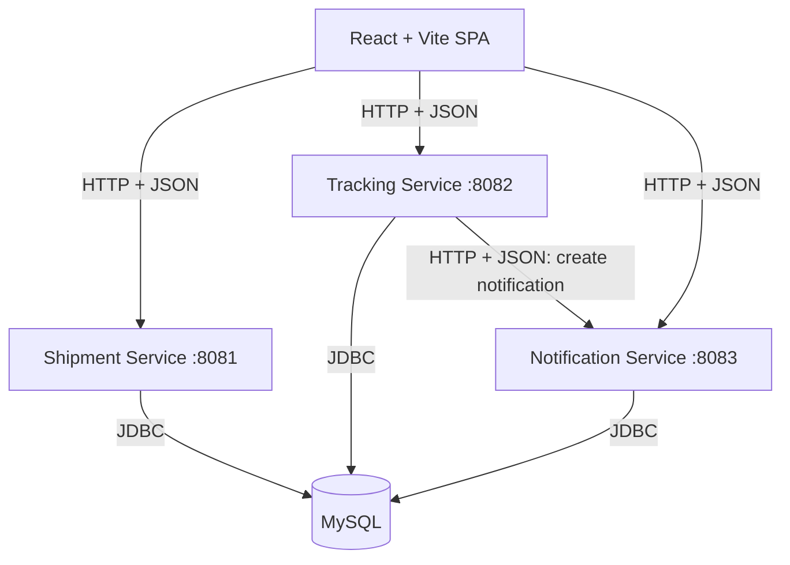

# ParcelFlow — Architecture and Technical Design

**Version:** 1.0  
**Architecture style:** Small HTTP-based microservices, React SPA, relational persistence

---

## 1. Architectural Principles

1. Each service owns a clearly defined business capability.
2. Services communicate through HTTP/JSON, not by importing one another's Java classes.
3. Each service has its own application entry point, configuration, handlers, business logic, and repository code.
4. JDBC is explicit and visible; avoid ORM abstractions in the baseline.
5. Use the simplest solution that demonstrates the concept. Do not add Kafka, Kubernetes, service discovery, or an API gateway unless the core system is already stable.
6. A shared MySQL server is acceptable for this educational version, but table ownership must remain clear. This is a pragmatic development setup, not full production isolation.

## 2. High-Level System



The frontend may call services directly in the baseline. In development, each service must allow requests from the Vite origin through a narrowly configured CORS policy. A reverse proxy/API gateway is an optional future enhancement, not a baseline dependency.

## 3. Service Responsibilities

### 3.1 Shipment Service — port 8081
**Owns:** shipment identity and shipment details.

Responsibilities:
- Create shipments and generate tracking IDs.
- Validate sender, recipient, origin, and destination.
- Retrieve shipment summary and current status.
- Expose health check.
- Persist data using JDBC.

Suggested package structure:
```text
shipment-service/
  src/main/java/com/parcelflow/shipment/
    ShipmentApplication.java
    config/Config.java
    http/ShipmentHandler.java
    http/HealthHandler.java
    model/Shipment.java
    dto/CreateShipmentRequest.java
    dto/ShipmentResponse.java
    service/ShipmentService.java
    repository/ShipmentRepository.java
    util/Json.java
    util/HttpResponses.java
  src/test/java/...
  pom.xml
```

### 3.2 Tracking Service — port 8082
**Owns:** tracking events/history and status transition rules.

Responsibilities:
- Retrieve a shipment's event timeline.
- Validate and record status changes.
- Keep current status aligned with the agreed source of truth.
- Notify Notification Service after a committed status update.
- Handle Notification Service timeout/unavailability without exposing stack traces.

For a simple implementation, Tracking Service can maintain a `tracking_events` table and a `shipment_status` table keyed by tracking ID. Shipment Service owns shipment details; Tracking Service owns status and history. Shipment lookup can be called over HTTP when a tracking page needs both shipment details and history.

Suggested package structure:
```text
tracking-service/
  src/main/java/com/parcelflow/tracking/
    TrackingApplication.java
    config/Config.java
    http/TrackingHandler.java
    http/HealthHandler.java
    model/TrackingEvent.java
    dto/UpdateStatusRequest.java
    service/TrackingService.java
    repository/TrackingRepository.java
    client/NotificationClient.java
    client/ShipmentClient.java
    util/Json.java
  src/test/java/...
  pom.xml
```

### 3.3 Notification Service — port 8083
**Owns:** in-app notification records.

Responsibilities:
- Accept a notification request from Tracking Service.
- Validate tracking ID, status, and message.
- Persist notification record through JDBC.
- List notifications by tracking ID.
- Expose health check.

It does not send real emails or SMS in the baseline.

Suggested package structure:
```text
notification-service/
  src/main/java/com/parcelflow/notification/
    NotificationApplication.java
    config/Config.java
    http/NotificationHandler.java
    http/HealthHandler.java
    model/Notification.java
    dto/CreateNotificationRequest.java
    service/NotificationService.java
    repository/NotificationRepository.java
    util/Json.java
  src/test/java/...
  pom.xml
```

## 4. Data Ownership and Database

Use one local MySQL instance for ease of setup, with distinct tables owned by each service. Services must not query or update tables owned by another service.

Suggested database: `parcelflow`.

### `shipments` — Shipment Service
| Column | Type | Notes |
|---|---|---|
| id | BIGINT AUTO_INCREMENT | Primary key |
| tracking_id | VARCHAR(32) | Unique, not null |
| sender_name | VARCHAR(100) | Not null |
| recipient_name | VARCHAR(100) | Not null |
| origin | VARCHAR(120) | Not null |
| destination | VARCHAR(120) | Not null |
| created_at | TIMESTAMP | Not null, default current timestamp |

### `shipment_status` — Tracking Service
| Column | Type | Notes |
|---|---|---|
| tracking_id | VARCHAR(32) | Primary key; logical reference, not cross-service FK |
| current_status | VARCHAR(32) | Not null |
| updated_at | TIMESTAMP | Not null |

### `tracking_events` — Tracking Service
| Column | Type | Notes |
|---|---|---|
| id | BIGINT AUTO_INCREMENT | Primary key |
| tracking_id | VARCHAR(32) | Indexed |
| status | VARCHAR(32) | Not null |
| location | VARCHAR(120) | Nullable |
| note | VARCHAR(255) | Nullable |
| event_time | TIMESTAMP | Not null, default current timestamp |

### `notifications` — Notification Service
| Column | Type | Notes |
|---|---|---|
| id | BIGINT AUTO_INCREMENT | Primary key |
| tracking_id | VARCHAR(32) | Indexed |
| title | VARCHAR(120) | Not null |
| message | VARCHAR(255) | Not null |
| status | VARCHAR(32) | Not null |
| created_at | TIMESTAMP | Not null, default current timestamp |
| delivery_state | VARCHAR(20) | `RECORDED` for in-app record |

Do not create foreign keys across service-owned tables. In a real deployment, services would normally have separately managed databases; for this project, separate ownership within one server keeps installation simple.

## 5. API Contracts

All request and response bodies use JSON with UTF-8 encoding. API paths are versioned with `/api/v1`.

### Shipment Service
| Method | Path | Purpose |
|---|---|---|
| `GET` | `/health` | Health check |
| `POST` | `/api/v1/shipments` | Create shipment |
| `GET` | `/api/v1/shipments/{trackingId}` | Get shipment summary |

Create request:
```json
{
  "senderName": "Krishna",
  "recipientName": "Aarav",
  "origin": "Amritsar",
  "destination": "Delhi"
}
```

Example response (`201 Created`):
```json
{
  "trackingId": "PF26A1B2C3",
  "senderName": "Krishna",
  "recipientName": "Aarav",
  "origin": "Amritsar",
  "destination": "Delhi",
  "currentStatus": "BOOKED",
  "createdAt": "2026-10-20T10:30:00"
}
```

Shipment Service must not claim that status is owned by it. `currentStatus` may be omitted from this response if the implementation chooses strict service ownership; the frontend can obtain current status from Tracking Service instead. Pick one response shape and keep it consistent in the code and frontend. Preferred: shipment response contains shipment details only; tracking endpoint returns current status.

### Tracking Service
| Method | Path | Purpose |
|---|---|---|
| `GET` | `/health` | Health check |
| `GET` | `/api/v1/tracking/{trackingId}` | Get current status and timeline |
| `POST` | `/api/v1/tracking/{trackingId}/events` | Record status update |

Update request:
```json
{
  "status": "IN_TRANSIT",
  "location": "Ludhiana Sorting Centre",
  "note": "Parcel departed from sorting centre"
}
```

Example response:
```json
{
  "trackingId": "PF26A1B2C3",
  "currentStatus": "IN_TRANSIT",
  "notificationRecorded": true,
  "events": [
    {
      "status": "BOOKED",
      "location": "Amritsar",
      "note": "Shipment registered",
      "eventTime": "2026-10-20T10:30:00"
    },
    {
      "status": "IN_TRANSIT",
      "location": "Ludhiana Sorting Centre",
      "note": "Parcel departed from sorting centre",
      "eventTime": "2026-10-20T11:15:00"
    }
  ]
}
```

The response can be split between the update response and the history GET response; keep contracts consistent.

### Notification Service
| Method | Path | Purpose |
|---|---|---|
| `GET` | `/health` | Health check |
| `POST` | `/api/v1/notifications` | Create in-app notification |
| `GET` | `/api/v1/notifications?trackingId={id}` | List notifications for a parcel |

Notification request:
```json
{
  "trackingId": "PF26A1B2C3",
  "status": "IN_TRANSIT",
  "title": "Parcel status updated",
  "message": "Your parcel is now in transit."
}
```

## 6. Cross-Service Flow

### 6.1 Create Shipment
1. React validates basic form fields.
2. React sends `POST /api/v1/shipments` to Shipment Service.
3. Handler parses JSON and calls `ShipmentService`.
4. Repository executes prepared SQL insert.
5. Service creates a `BOOKED` status record and initial event through a documented initialization path. Preferred simple implementation: Shipment Service calls Tracking Service after creating shipment; if this call fails, return a clear error and provide a retry/admin recovery option. Do not silently create a parcel without its initial tracking state.
6. React displays the generated tracking ID.

### 6.2 Update Status
1. React sends the update request to Tracking Service.
2. Tracking Service verifies the tracking ID exists by calling Shipment Service.
3. Tracking Service validates the status transition.
4. A JDBC transaction updates `shipment_status` and inserts `tracking_events`.
5. After commit, Tracking Service sends an HTTP request to Notification Service with a short connection/read timeout.
6. If notification succeeds, return `notificationRecorded: true`.
7. If notification fails, the status update remains committed; return a clear partial-success response (for example `notificationRecorded: false`) and log a safe message. The UI should say “Status updated; notification could not be recorded.” A retry/outbox is a stretch goal.

### 6.3 View Tracking
1. React requests shipment details from Shipment Service.
2. React requests current status and timeline from Tracking Service.
3. React renders the summary and chronological timeline.
4. React requests notification records when the user opens the notification panel.

## 7. HTTP and Networking Design

- Use Java's built-in `HttpServer` for inbound HTTP.
- Use Java's `java.net.http.HttpClient` for outbound service calls.
- Set finite connection/request timeouts.
- Parse URL path segments safely and URL-decode query parameters.
- Use explicit `Content-Type: application/json; charset=utf-8`.
- Handle CORS preflight (`OPTIONS`) for the frontend origin.
- Keep service base URLs configurable with environment variables.
- Do not use raw TCP sockets for core APIs; HTTP itself demonstrates networking concepts. A small optional socket exercise may be added separately if the course specifically requires socket programming.

## 8. Java Layering

Recommended request path:

`HttpHandler → DTO parsing/validation → Service/business rules → Repository/JDBC → MySQL`

- **HTTP handler:** route, parse request, set response code.
- **DTO:** represent input/output payloads.
- **Service:** business rules and orchestration.
- **Repository:** SQL and row mapping only.
- **Model:** domain data.
- **Utility:** JSON, response helpers, config.
- **Tests:** validate business rules and API contracts.

Avoid putting SQL directly in HTTP handlers.

## 9. Error Contract

Use one consistent shape:
```json
{
  "error": {
    "code": "SHIPMENT_NOT_FOUND",
    "message": "No shipment was found for the supplied tracking ID."
  }
}
```

Suggested status mapping:
- `400 Bad Request`: invalid JSON, missing fields, invalid status.
- `404 Not Found`: tracking ID does not exist.
- `409 Conflict`: invalid transition or shipment already delivered.
- `500 Internal Server Error`: unexpected internal error; do not expose stack trace.
- `503 Service Unavailable`: required downstream dependency unavailable.
- `201 Created`: successful creation.
- `200 OK`: successful lookup/update.

## 10. Configuration

Suggested environment variables:
```text
DB_HOST=localhost
DB_PORT=3306
DB_NAME=parcelflow
DB_USER=parcelflow_app
DB_PASSWORD=change_me_locally
SHIPMENT_SERVICE_PORT=8081
TRACKING_SERVICE_PORT=8082
NOTIFICATION_SERVICE_PORT=8083
SHIPMENT_SERVICE_URL=http://localhost:8081
TRACKING_SERVICE_URL=http://localhost:8082
NOTIFICATION_SERVICE_URL=http://localhost:8083
FRONTEND_ORIGIN=http://localhost:5173
```

Do not commit actual passwords. Provide `.env.example` with placeholders. For Docker Compose, service URLs must use Compose service names, not `localhost`, when one container calls another.

## 11. Build and Run Strategy

Recommended repository layout:
```text
parcelflow/
  frontend/
  shipment-service/
  tracking-service/
  notification-service/
  database/
    schema.sql
  docker-compose.yml
  .env.example
  README.md
  docs/
    prd.md
    Architecture.md
    Rules.md
    Design.md
    Tasks.md
    Memory.md
```

Each Java service is a separate Maven project initially. Avoid a complex multi-module Maven build until all services work independently. Shared DTO classes should not be imported across services; duplicate the small API DTO definitions where necessary so services remain independent.

## 12. Testing Strategy

- Unit tests: required-field validation, allowed status transitions, tracking ID format.
- Repository/integration tests: insert/read against a local MySQL test database where practical.
- API tests: happy path, invalid input, unknown tracking ID, invalid transition.
- Failure test: stop Notification Service and verify status remains updated with an explicit partial-success result.
- Frontend tests: manually verify loading, empty, success, and error states; automated UI tests are optional.

## 13. Architecture Trade-offs

- **Built-in HttpServer vs Spring Boot:** HttpServer exposes networking and routing fundamentals with fewer abstractions. Spring Boot is more common in production but can hide some fundamentals and increases setup.
- **JDBC vs JPA:** JDBC is explicit and meets the learning objective; it requires careful resource management.
- **Shared MySQL instance vs database per service:** shared MySQL is easier for a college project. Table ownership is enforced by code conventions, not physical isolation.
- **Synchronous notification call vs message broker:** synchronous HTTP is easy to understand. An outbox/message broker would be more reliable but is outside the baseline.
