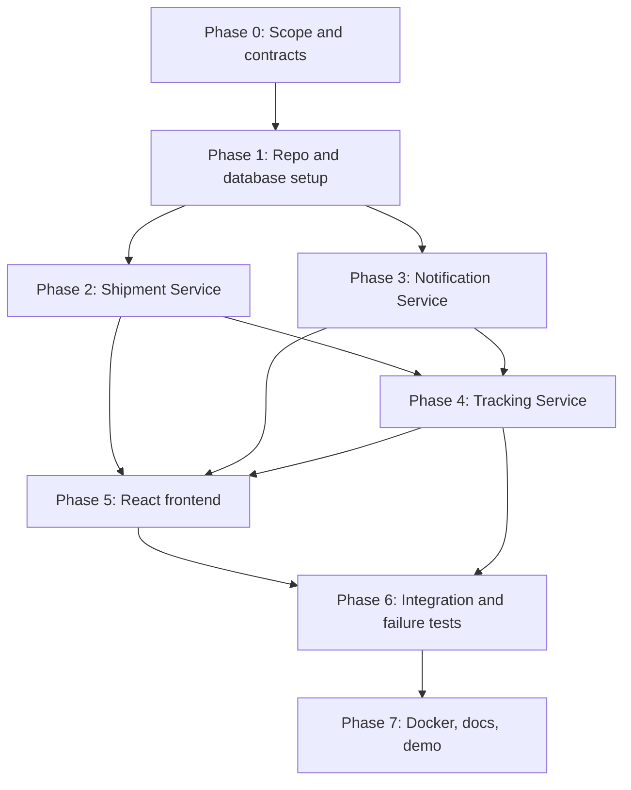

# ParcelFlow — Phased Implementation Plan and Agent Workflow

This plan is deliberately sequential. Stabilize contracts first, implement services independently, and integrate only after each component passes its own checks.

## 1. Collaboration Model

Recommended roles (one person can act as multiple roles):
- **Coordinator / Integrator:** owns architecture, API contracts, shared schema, integration, and final demo.
- **Backend Agent A — Shipment:** owns `shipment-service/`.
- **Backend Agent B — Tracking:** owns `tracking-service/`.
- **Backend Agent C — Notification:** owns `notification-service/`.
- **Frontend Agent:** owns `frontend/`.
- **QA / Documentation Agent:** owns API test collection, regression checklist, README, and review.

For a solo student project, follow the same phases sequentially. If using multiple coding agents, assign exclusive file ownership. Do not ask multiple agents to edit the same file at once.

## 2. Dependency Map

## 3. Phase 0 — Freeze Scope and Contracts

**Owner:** Coordinator  
**Parallel work:** none until contracts are agreed.

Tasks:
- [ ] Read PRD and Architecture.
- [ ] Confirm Java 21, Maven, built-in `HttpServer`, Jackson, JDBC, MySQL Connector/J, React + Vite.
- [ ] Confirm ports: Shipment `8081`, Tracking `8082`, Notification `8083`, Vite `5173`.
- [ ] Freeze endpoint paths, request/response JSON, status names, and error format.
- [ ] Decide exact shipment initialization flow: after shipment insert, initialize `BOOKED` state through Tracking Service; document recovery if the call fails.
- [ ] Freeze database table ownership and `schema.sql`.
- [ ] Create `.env.example`, `.gitignore`, and a README skeleton.

**Acceptance:** Every agent can implement its component without guessing endpoint names, JSON fields, status values, or table ownership.

## 4. Phase 1 — Repository and Database Foundation

**Owner:** Coordinator or Backend Agent A  
**Tasks:**
- [ ] Create root repository layout.
- [ ] Create database schema and a local least-privilege application user.
- [ ] Add example environment variables.
- [ ] Create each Maven project with Java 21 compiler configuration.
- [ ] Add Jackson, MySQL Connector/J, and JUnit 5 dependencies as needed.
- [ ] Add a small shared pattern for JSON responses within each service; do not create a shared runtime library unless needed.
- [ ] Verify database connectivity with a tiny smoke test.

**Acceptance:**
- Schema initializes from a clean database.
- Each service compiles from its own directory.
- No real credentials are committed.
- Commands are documented.

## 5. Phase 2 — Shipment Service

**Owner:** Backend Agent A  
**Exclusive ownership:** `shipment-service/`

Tasks:
- [ ] Implement configuration loading and validation.
- [ ] Implement `Shipment` model and request/response DTOs.
- [ ] Implement `ShipmentRepository` with prepared SQL and try-with-resources.
- [ ] Implement `ShipmentService` validation and tracking ID generation.
- [ ] Implement `POST /api/v1/shipments`.
- [ ] Implement `GET /api/v1/shipments/{trackingId}`.
- [ ] Implement `GET /health`.
- [ ] Return consistent JSON errors.
- [ ] Add unit tests for required fields and tracking ID generation.
- [ ] Add API smoke-test instructions.

**Acceptance:**
- Valid create request returns `201` and a unique tracking ID.
- Data survives service restart.
- Unknown ID returns `404`.
- Invalid input returns `400`.
- SQL is parameterized and resources are closed.
- Shipment Service does not access Tracking or Notification tables.

## 6. Phase 3 — Notification Service

**Owner:** Backend Agent C  
**Exclusive ownership:** `notification-service/`

Tasks:
- [ ] Implement notification DTO/model/service/repository.
- [ ] Implement `POST /api/v1/notifications`.
- [ ] Implement `GET /api/v1/notifications?trackingId=...`.
- [ ] Implement `GET /health`.
- [ ] Validate required values and use prepared statements.
- [ ] Add tests for notification creation and lookup.

**Acceptance:**
- Valid notification requests are persisted and retrievable.
- Invalid requests return a structured `400`.
- Listing by tracking ID does not return unrelated records.
- The service records in-app notifications only; no claim of external delivery.

## 7. Phase 4 — Tracking Service

**Owner:** Backend Agent B  
**Dependencies:** Phases 1–3 API/schema decisions must be stable.  
**Exclusive ownership:** `tracking-service/`

Tasks:
- [ ] Implement status enum/allow-list and transition rules.
- [ ] Implement tracking status and event repositories.
- [ ] Implement transaction that updates current status and inserts an event atomically.
- [ ] Implement `GET /api/v1/tracking/{trackingId}`.
- [ ] Implement `POST /api/v1/tracking/{trackingId}/events`.
- [ ] Implement `GET /health`.
- [ ] Implement `ShipmentClient` using JDK `HttpClient` to verify shipment existence.
- [ ] Implement `NotificationClient` using JDK `HttpClient` with finite timeouts.
- [ ] Record initial `BOOKED` state through the agreed initialization endpoint/flow.
- [ ] Handle notification failure after transaction commit as partial success.
- [ ] Add tests for allowed/blocked status transitions and error mapping.

**Acceptance:**
- Timeline includes the initial `BOOKED` event.
- Status and event history update atomically.
- Unknown tracking IDs return `404`.
- Invalid transitions return `409`.
- Notification service failure does not roll back a committed status update.
- No database transaction remains open during an HTTP call.

## 8. Phase 5 — React + Vite Frontend

**Owner:** Frontend Agent  
**Dependencies:** Phase 0 API contracts; backend endpoints can be mocked temporarily but mocks must be labelled and removed/disabled for final integration.  
**Exclusive ownership:** `frontend/`

Tasks:
- [ ] Scaffold React with Vite.
- [ ] Add `.env.example` with the three API base URLs.
- [ ] Implement one shared fetch helper with JSON parsing and useful errors.
- [ ] Implement shipment API, tracking API, and notification API modules.
- [ ] Build app shell and service health indicators.
- [ ] Build create-shipment form.
- [ ] Build tracking search and shipment summary.
- [ ] Build tracking timeline and status badges.
- [ ] Build demo operator status form.
- [ ] Build notification list.
- [ ] Add loading, empty, error, and partial-success states.
- [ ] Make the layout responsive and keyboard-accessible.

**Acceptance:**
- Frontend builds without errors.
- No backend secrets are included in Vite variables.
- API URLs come from environment variables.
- The user can create, find, update, and view a parcel through the UI after integration.
- Notification failure is displayed honestly.

## 9. Phase 6 — Integration and Regression

**Owner:** Coordinator + QA  
Tasks:
- [ ] Start MySQL and all three services.
- [ ] Start Vite and verify CORS.
- [ ] Run end-to-end create → track → update → notification flow.
- [ ] Test invalid JSON, missing fields, unknown IDs, invalid transitions, and duplicate submissions.
- [ ] Stop Notification Service and verify partial-success behavior.
- [ ] Restart services and confirm persisted data remains.
- [ ] Verify health checks and useful browser console/network diagnostics.
- [ ] Check that no service reads another service's tables.
- [ ] Fix integration issues without silently changing API contracts.
- [ ] Update `Memory.md` with tested behavior and known issues.

**Acceptance:** All PRD success criteria pass, and a fresh checkout can be run using the documented instructions.

## 10. Phase 7 — Docker, Documentation, and Final Demo

**Owner:** Coordinator / Documentation Agent  
Tasks:
- [ ] Add Dockerfiles only after local execution works.
- [ ] Add Compose configuration for MySQL and services; optionally include frontend.
- [ ] Use Compose DNS service names for container-to-container calls.
- [ ] Add health checks and dependency readiness handling where practical.
- [ ] Write README setup steps for both local Java execution and Docker Compose.
- [ ] Include endpoint table, environment variables, architecture diagram, limitations, and demo script.
- [ ] Run the full test checklist from a clean state.
- [ ] Prepare a short viva explanation: service boundaries, JDBC flow, HTTP calls, transaction, concurrency, and failure handling.
- [ ] Record the exact final commands and known limitations in `Memory.md`.

**Acceptance:** The application can be demonstrated from a clean start, and documentation matches actual code.

## 11. Integration Contract Between Agents

Before coding, each service agent must agree to:
- Exact route paths and HTTP methods.
- Exact JSON field names and types.
- Status codes and error response shape.
- Database table ownership.
- Environment variable names.
- Timeouts and downstream failure behavior.

When a contract must change, the agent proposes the change in a short note; the Coordinator approves it; then Architecture, Tasks, API tests, and frontend code are updated together.

## 12. Pull Request / Review Checklist

- [ ] Scope matches assigned phase.
- [ ] No unapproved dependencies or architecture changes.
- [ ] Code compiles/builds.
- [ ] Relevant tests were run and results are stated accurately.
- [ ] No secrets or local-only files.
- [ ] API and schema contracts remain consistent.
- [ ] Errors and loading states are covered.
- [ ] Documentation/Memory updated where needed.
- [ ] Reviewer can reproduce the test using the listed command.

## 13. Recommended Order for a Solo Developer

1. Make MySQL and Shipment Service work first.
2. Make Notification Service work independently.
3. Implement Tracking Service and test its transaction before building the UI.
4. Build the frontend against stable APIs.
5. Integrate the full workflow.
6. Add Docker and polish only after the application runs locally.

This order avoids building a polished UI against unstable APIs.
